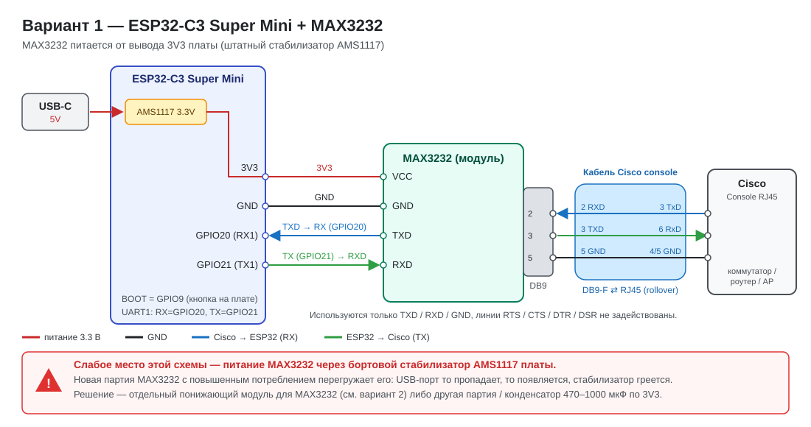
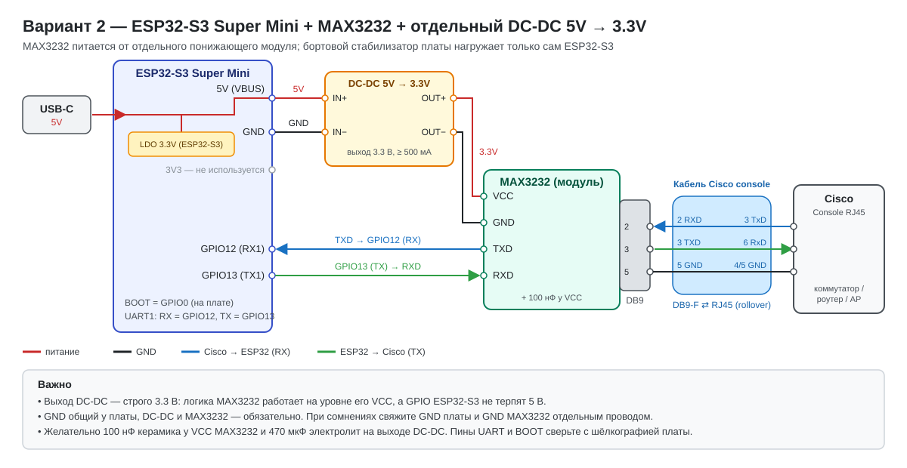

# ESP32 Cisco Console Server (ESP32-C3 / ESP32-S3)

**Version 1.0.0**

A remote COM port for console access to network equipment (Cisco and compatible) over Wi-Fi. An ESP32 + MAX3232 turn a device's local console port into a TCP socket reachable over the network — no need to physically plug a laptop into every switch, router or access point.

One sketch builds for both boards: the board is detected automatically from the chip selected in Arduino IDE.

| | ESP32-C3 Super Mini | ESP32-S3 Super Mini |
|---|---|---|
| MAX3232 power | from the board's 3V3 (onboard AMS1117) | from a separate 5V → 3.3V DC-DC module |
| UART pins | RX1 = GPIO20, TX1 = GPIO21 | RX1 = GPIO12, TX1 = GPIO13 |
| BOOT button | GPIO9 | GPIO0 |
| Fallback AP name | `ESP32-Console-XXXX` | `ESP32-S3-Console-XXXX` |
| Wiring diagram | `schemes/schema-esp32-c3-max3232.svg` | `schemes/schema-esp32-s3-max3232-dcdc.svg` |

`XXXX` is the end of the board's MAC address, so several units can be told apart.

> 🤖 The firmware and web portal were built together with **Claude** (Anthropic).

## Features

**Console bridge**
- **TCP ⇄ UART bridge** on port `8888`: buffered transfer, proper Telnet negotiation (no doubled characters, CR LF / CR NUL collapsed into one CR, `0xFF` escaped in both directions).
- **RFC 2217** — virtual COM-port drivers (e.g. com2tcp / hub4com on Windows, `socat` / `ser2net`-style clients on Linux) can set the UART speed from the terminal program. The speed returns to the saved value when the session ends.
- **Console speed auto-detect** — by button on the portal or automatically when a client connects (see below).
- **Single session** — a second client gets `BUSY`. A reconnect from the same IP replaces the previous session only if that session is stale (not authenticated yet or no input for 60 s), so users behind one NAT address don't kick each other.
- **Session password** — `Password:` prompt, characters shown as `*`, Backspace supported, 30 s to enter it.
- **Idle timeout** (optional) and **TCP keepalive** — a client that disappeared (laptop asleep, out of Wi-Fi) is dropped in about a minute instead of keeping the line busy forever.
- **Network White List** by IP/CIDR and optional **IP lockout** after 3 wrong passwords.

**Network**
- **Fallback access point** when the configured Wi-Fi is unreachable or not set. While in fallback mode the device **retries the configured network every 3 minutes** in the background and switches back automatically — so after a power cut it reconnects even if the router boots slower than the ESP32.
- If the working network is lost for 10 minutes, the device restarts (helps on boards whose radio sometimes hangs).
- **WPA2-Enterprise (802.1X, PEAP/MSCHAPv2)**, **static IP**, adjustable **transmit power**.
- **mDNS** — the portal is reachable at `http://console-XXXX.local` (hostname is configurable).
- **WireGuard VPN client** (optional, compile-time flag).

**Web portal** (port 80, dark theme, RU/EN)
- Status, settings, Wi-Fi setup with network scan, WireGuard, **firmware update over the web (OTA)**.
- Optional portal password (HTTP Basic Auth, user `admin`), can reuse the console password.
- CSRF protection on all forms, HTML escaping of everything shown (incl. scanned network names).
- **BOOT button reset** — hold BOOT for 5 seconds to wipe the Wi-Fi settings and portal password and restore the factory fallback-AP password.

All settings are stored in NVS and survive reboots and firmware updates.

## Hardware

Common parts: ESP32 Super Mini board, a MAX3232 (RS-232 ⇄ TTL) module with DB9, and a Cisco console cable (DB9-F ⇄ RJ45).

### ESP32-C3 Super Mini



| ESP32-C3 | MAX3232 module |
|---|---|
| GPIO20 (RX1) | TXD |
| GPIO21 (TX1) | RXD |
| 3V3 | VCC |
| GND | GND |

The MAX3232 is powered from the board's own AMS1117. Some MAX3232 batches draw more current and overload it: the USB port keeps disappearing and reappearing and the regulator gets hot. In that case power the MAX3232 from a separate 3.3 V DC-DC module (as in the S3 diagram).

### ESP32-S3 Super Mini + separate DC-DC



| ESP32-S3 | Connects to |
|---|---|
| 5V (VBUS) | DC-DC IN+ |
| GND | DC-DC IN− |
| GPIO12 (RX1) | MAX3232 TXD |
| GPIO13 (TX1) | MAX3232 RXD |
| — | DC-DC OUT+ → MAX3232 VCC, OUT− → MAX3232 GND |

- The DC-DC output must be **exactly 3.3 V**: ESP32 GPIOs are not 5 V tolerant.
- GND must be common between the board, the DC-DC module and the MAX3232.
- Recommended: 100 nF ceramic at MAX3232 VCC and 470 µF electrolytic on the DC-DC output.

Only TXD / RXD / GND are used. Cisco console cable mapping: DB9 pin 2 ↔ RJ45 pin 3, DB9 pin 3 ↔ RJ45 pin 6, DB9 pin 5 ↔ RJ45 pin 4/5.

## Building

The sketch folder contains `esp32-tcp-com.ino` and several `.h` tabs (`board_config.h`, `lang.h`, `settings.h`, `telnet.h`, `console.h`, `net_mgr.h`, `web.h`). Open the `.ino` — Arduino IDE opens all tabs. The folder must be named `esp32-tcp-com`.

### 1. Board package

Arduino IDE → Boards Manager → **esp32 by Espressif Systems**, version **3.x** (tested build: 3.3.12). No extra libraries are needed for the default build.

### 2. Choose the board — this selects the hardware variant

| Setting (Tools menu) | ESP32-C3 Super Mini | ESP32-S3 Super Mini |
|---|---|---|
| Board | **ESP32C3 Dev Module** | **ESP32S3 Dev Module** |
| USB CDC On Boot | Enabled (for Serial Monitor over USB) | Enabled (for Serial Monitor over USB) |
| Flash Size | 4MB | 4MB (or what your board has) |
| Partition Scheme | Default 4MB with spiffs — or **Minimal SPIFFS (1.9MB APP with OTA)** if WireGuard is enabled | Default 4MB with spiffs |

Pins, BOOT button, buffer sizes and the fallback AP name are picked automatically (`board_config.h`). If the board is not a C3 or S3, compilation stops with an error.

Firmware size for reference (core 3.3.12): C3 — 94 % of the default app slot, C3 with WireGuard — 97 %; S3 — 85 % / 89 %. Keep a partition scheme **with OTA** — otherwise web firmware update won't work.

### 3. Build options

At the top of `esp32-tcp-com.ino` — uncomment what you need. These lines must stay **above** all `#include`s.

```cpp
// #define USE_BAN_LIST                    // lock an IP for 1 hour after 3 wrong console passwords
// #define USE_WIREGUARD                   // /vpn page and WireGuard client (needs the patched library)
// #define RX1_PIN 12                      // override UART pins
// #define TX1_PIN 13
```

Factory defaults (used until something is saved in the portal) are right below: `DEFAULT_SSID`, `DEFAULT_PASSWORD`, `AP_DEFAULT_PASSWORD` (fallback-AP password, `console1234` — change it before flashing), ports, timeouts.

### 4. WireGuard (only with `USE_WIREGUARD`)

The original `WireGuard-ESP32-Arduino` library doesn't build on core 3.x (GCC 14, ESP-IDF 5) and crashes there without TCPIP core locking. Use the patched copy from this repository: copy `extras/WireGuard-ESP32` into `Documents/Arduino/libraries/` (delete any other `WireGuard-ESP32` folder first). Changes: removed `tcpip_adapter.h`, added a missing prototype, `LOCK_TCPIP_CORE()` around lwIP calls, `setPersistentKeepalive()`.

### 5. Flash

- First time — over USB as usual.
- Later — from the portal: **Firmware update**, upload the `.bin` from **Sketch → Export Compiled Binary** (the file without `bootloader`/`merged` in its name). The firmware must be built for the same chip.

### Command line (arduino-cli)

```bash
arduino-cli compile -b esp32:esp32:esp32c3 --board-options CDCOnBoot=cdc esp32-tcp-com
arduino-cli compile -b esp32:esp32:esp32s3 --board-options CDCOnBoot=cdc esp32-tcp-com
# with WireGuard on C3 — larger app partition:
arduino-cli compile -b esp32:esp32:esp32c3 --board-options CDCOnBoot=cdc,PartitionScheme=min_spiffs esp32-tcp-com
```

## First boot

1. If no network is configured, the device starts the fallback AP `ESP32-Console-XXXX` / `ESP32-S3-Console-XXXX` with the password from `AP_DEFAULT_PASSWORD` (`console1234` unless you changed it). No Serial Monitor needed.
2. Connect to it and open `http://192.168.4.1` — no portal login in this mode.
3. **Wi-Fi** → scan → pick the network → password (or WPA2-Enterprise) → **Save and restart**.

## Web portal

| Page | Purpose |
|---|---|
| `/` | status: console, security, Wi-Fi, system; speed detection, client disconnect, restart |
| `/settings` | session and portal passwords, idle timeout, hostname, fallback-AP password, White List, static IP, UART speed, auto-detect |
| `/wifi` | network scan/selection, regular or WPA2-Enterprise, transmit power |
| `/vpn` | WireGuard (only when built with `USE_WIREGUARD`) |
| `/update` | firmware update |

Password fields are never shown back: leave a field empty to keep the saved password, or tick **No password** to remove it.

## Connecting to the console

```bash
telnet <device-ip-or-name.local> 8888
```

With a session password the device sends `AUTH_REQUIRED` and a `Password:` prompt. In PuTTY use connection type **Telnet** (not Raw).

Service messages the client may see: `CONNECTED_NO_AUTH`, `AUTH_OK`, `AUTH_FAILED`, `AUTH_TIMEOUT`, `BUSY`, `IDLE_TIMEOUT`, `KICKED_BY_ADMIN`, `SESSION_TAKEN_OVER`, `YOUR_IP_IS_LOCKED_OUT`, `AUTOBAUD: …`.

> `show running-config` stopping at `--More--` is IOS pagination — use `terminal length 0`. 9600 baud really is ~960 bytes/s.

## Console speed auto-detect

The device tries speeds one by one (the saved speed first — if it answers, nothing else is tried). At each speed it sends **Ctrl+U** (clear the input line) and **Enter** and checks the answer: a readable prompt (`Router>`, `Switch#`, `Password:`) means the speed is right, garbage means it isn't. The detected speed is saved.

- **Detect speed** button on the status page (only when no client is connected).
- **Detect automatically when a client connects** in Settings — runs before the session starts (0.5–4 s), the client sees `AUTOBAUD: 9600 baud`.

It needs the device to answer Enter with a prompt, so it won't work while the device is booting or sits silently in some menus. Ctrl+U clears whatever garbage the device received at wrong speeds, so Enter doesn't execute it as a command.

## WireGuard

On `/vpn`: device private key (`wg genkey`), server public key, endpoint and port, device tunnel IP (e.g. `10.0.0.2`), persistent keepalive (25 s keeps NAT open so the device stays reachable). The tunnel starts after Wi-Fi connects and right after saving. Before starting, the clock is synced over NTP — WireGuard handshakes carry a timestamp and the server rejects ones older than it has already seen (after a reboot the ESP32 would think it's 1970). All non-local traffic of the device goes through the tunnel; the LAN keeps working directly.

## Troubleshooting

- **USB port keeps reconnecting, regulator hot** — MAX3232 overloads the onboard AMS1117; power it from a separate 3.3 V DC-DC.
- **Access point invisible / unstable Wi-Fi** — power sag on transmit. Keep transmit power at 8.5 dBm (default), add 470–1000 µF on 3V3/GND.
- **Device stays on the fallback AP** — it retries the saved network every 3 minutes when nobody is connected to the AP; check the network name/password on `/wifi`.
- **Console silent** — check TX/RX. Some devices are picky about the console port (an FTDI cable may work where a CH340 doesn't); a loop RTS↔CTS / DTR↔DSR at the console connector is a known workaround. Try another unit — the device's own console port can be faulty.
- **"The form has expired"** — the device restarted since the page was opened; reload the page.

## Security notes

- Passwords are stored in NVS in plain text and travel over plain HTTP/Telnet — meant for a trusted network or a VPN, not for direct internet exposure.
- The fallback-AP password is the same for every unit flashed with the same firmware (`AP_DEFAULT_PASSWORD`, and the repository default is public). Change it in the sketch before flashing or on the portal (Settings). It is shown on the status page — set a portal password if the portal is reachable by others.
- The portal on the fallback AP doesn't ask for the portal password; access is limited by the AP password.
- Anyone with physical access can wipe Wi-Fi settings and the portal password and restore the factory AP password with the BOOT button — intentional recovery path.
- Speed detection and Wi-Fi scanning block the bridge for a few seconds.

## Changelog

### 1.0.0
- One sketch for ESP32-C3 and ESP32-S3 with automatic board detection; code split into tabs.
- Console speed auto-detect; RFC 2217 speed control.
- Fallback AP retries the configured network in the background; restart after 10 min without Wi-Fi.
- Password entry timeout, idle timeout, TCP keepalive, stale-session takeover.
- Web firmware update (OTA), mDNS hostname, transmit power setting, fallback-AP password configurable in the sketch (`AP_DEFAULT_PASSWORD`) and on the portal.
- Security: XSS fix (escaping of `'`), CSRF tokens, open-redirect fix, input validation, password fields never echoed back.
- WireGuard: NTP sync before start, safe restart of the tunnel, keepalive setting, patched library for core 3.x.

## License

Use, modify and share freely — built for a personal home/office infrastructure project.
