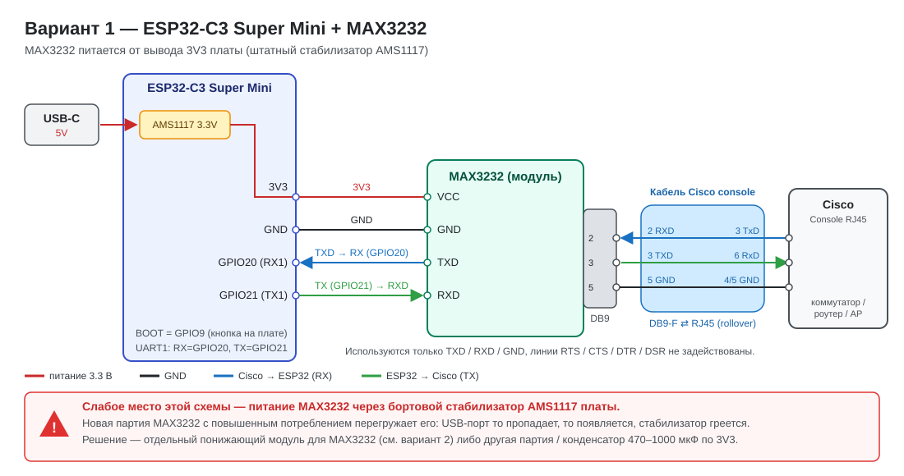
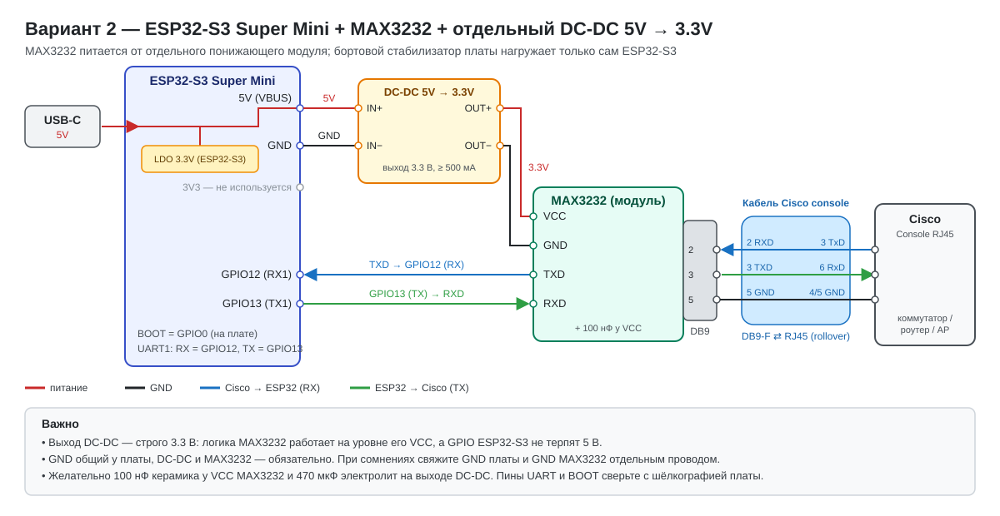

# ESP32 Cisco Console Server (ESP32-C3 / ESP32-S3)

**Версия 1.0.0**

Удалённый COM-порт для консольного доступа к сетевому оборудованию (Cisco и совместимому) через Wi-Fi. ESP32 + MAX3232 превращают локальный консольный порт устройства в TCP-сокет, доступный из сети, — без физического подключения ноутбука к каждому свитчу, роутеру или точке доступа.

Один скетч собирается для обеих плат: плата определяется автоматически по чипу, выбранному в Arduino IDE.

| | ESP32-C3 Super Mini | ESP32-S3 Super Mini |
|---|---|---|
| Питание MAX3232 | от 3V3 платы (штатный AMS1117) | от отдельного понижающего модуля 5V → 3.3V |
| Пины UART | RX1 = GPIO20, TX1 = GPIO21 | RX1 = GPIO12, TX1 = GPIO13 |
| Кнопка BOOT | GPIO9 | GPIO0 |
| Имя резервной AP | `ESP32-Console-XXXX` | `ESP32-S3-Console-XXXX` |
| Схема подключения | `schemes/schema-esp32-c3-max3232.svg` | `schemes/schema-esp32-s3-max3232-dcdc.svg` |

`XXXX` — хвост MAC-адреса платы, чтобы различать несколько устройств.

> 🤖 Прошивка и веб-портал разработаны в паре с **Claude** (Anthropic).

## Возможности

**Консольный мост**
- **Мост TCP ⇄ UART** на порту `8888`: буферизованная передача, корректное согласование Telnet (без задвоения символов, CR LF / CR NUL схлопываются в один CR, байт `0xFF` экранируется в обе стороны).
- **RFC 2217** — драйверы виртуальных COM-портов (например, com2tcp / hub4com в Windows, клиенты в духе `socat` / `ser2net` в Linux) могут задавать скорость UART прямо из терминальной программы. После окончания сессии скорость возвращается к сохранённой.
- **Автоопределение скорости консоли** — кнопкой на портале или автоматически при подключении клиента (см. ниже).
- **Одна сессия** — второй клиент получает `BUSY`. Повторное подключение с того же IP вытесняет прежнюю сессию, только если она «зависла» (ещё не авторизована или без ввода дольше 60 с), — поэтому пользователи за одним NAT не выбивают друг друга.
- **Пароль на сессию** — приглашение `Password:`, символы отображаются как `*`, работает Backspace, на ввод даётся 30 с.
- **Отключение при простое** (по желанию) и **TCP keepalive** — пропавший клиент (ноутбук уснул, вышел из Wi-Fi) отключается примерно за минуту, а не держит линию занятой вечно.
- **White List сетей** по IP/CIDR и опциональная **блокировка IP** после 3 неверных паролей.

**Сеть**
- **Резервная точка доступа**, если рабочая сеть недоступна или не настроена. В этом режиме устройство **раз в 3 минуты пробует подключиться к рабочей сети** в фоне и само возвращается в неё — после отключения света оно переподключится, даже если роутер загружается дольше ESP32.
- Если рабочая сеть пропала на 10 минут — перезагрузка (помогает на платах, где радио иногда «зависает»).
- **WPA2-Enterprise (802.1X, PEAP/MSCHAPv2)**, **статический IP**, настраиваемая **мощность передатчика**.
- **mDNS** — портал доступен по адресу `http://console-XXXX.local` (имя хоста настраивается).
- **Клиент WireGuard VPN** (опционально, флаг сборки).

**Веб-портал** (порт 80, тёмная тема, RU/EN)
- Статус, настройки, Wi-Fi со сканированием сетей, WireGuard, **обновление прошивки через веб (OTA)**.
- Пароль на портал (HTTP Basic Auth, логин `admin`), можно использовать пароль консоли.
- Защита от CSRF во всех формах, экранирование всего выводимого (в том числе имён найденных сетей).
- **Сброс кнопкой BOOT** — удержание 5 секунд стирает Wi-Fi-настройки и пароль портала и возвращает заводской пароль резервной AP.

Все настройки хранятся в NVS и переживают перезагрузку и обновление прошивки.

## Железо

Общие компоненты: плата ESP32 Super Mini, модуль MAX3232 (RS-232 ⇄ TTL) с DB9 и консольный кабель Cisco (DB9-F ⇄ RJ45).

### ESP32-C3 Super Mini



| ESP32-C3 | Модуль MAX3232 |
|---|---|
| GPIO20 (RX1) | TXD |
| GPIO21 (TX1) | RXD |
| 3V3 | VCC |
| GND | GND |

MAX3232 питается от штатного AMS1117 платы. Некоторые партии MAX3232 потребляют больше и перегружают его: USB-порт то пропадает, то появляется, стабилизатор греется. Тогда запитайте MAX3232 от отдельного DC-DC на 3.3 В (как на схеме для S3).

### ESP32-S3 Super Mini + отдельный DC-DC



| ESP32-S3 | Куда подключается |
|---|---|
| 5V (VBUS) | DC-DC IN+ |
| GND | DC-DC IN− |
| GPIO12 (RX1) | MAX3232 TXD |
| GPIO13 (TX1) | MAX3232 RXD |
| — | DC-DC OUT+ → MAX3232 VCC, OUT− → MAX3232 GND |

- Выход DC-DC — **строго 3.3 В**: GPIO ESP32 не терпят 5 В.
- GND общий у платы, DC-DC и MAX3232.
- Рекомендуется 100 нФ керамика у VCC MAX3232 и 470 мкФ электролит на выходе DC-DC.

Используются только TXD / RXD / GND. Раскладка консольного кабеля Cisco: DB9 pin 2 ↔ RJ45 pin 3, DB9 pin 3 ↔ RJ45 pin 6, DB9 pin 5 ↔ RJ45 pin 4/5.

## Сборка

В папке скетча лежат `esp32-tcp-com.ino` и несколько вкладок `.h` (`board_config.h`, `lang.h`, `settings.h`, `telnet.h`, `console.h`, `net_mgr.h`, `web.h`). Откройте `.ino` — Arduino IDE откроет все вкладки. Папка должна называться `esp32-tcp-com`.

### 1. Пакет плат

Arduino IDE → Менеджер плат → **esp32 by Espressif Systems**, версия **3.x** (проверенная сборка: 3.3.12). Для обычной сборки дополнительные библиотеки не нужны.

### 2. Выбор платы — он и определяет вариант железа

| Параметр (меню «Инструменты») | ESP32-C3 Super Mini | ESP32-S3 Super Mini |
|---|---|---|
| Плата | **ESP32C3 Dev Module** | **ESP32S3 Dev Module** |
| USB CDC On Boot | Enabled (для Serial Monitor по USB) | Enabled (для Serial Monitor по USB) |
| Flash Size | 4MB | 4MB (или сколько на вашей плате) |
| Partition Scheme | Default 4MB with spiffs — или **Minimal SPIFFS (1.9MB APP with OTA)**, если включён WireGuard | Default 4MB with spiffs |

Пины, кнопка BOOT, размеры буферов и имя резервной AP выбираются автоматически (`board_config.h`). Если выбрана плата не C3 и не S3, сборка остановится с ошибкой.

Размер прошивки для ориентира (ядро 3.3.12): C3 — 94 % стандартного раздела, C3 с WireGuard — 97 %; S3 — 85 % / 89 %. Схема разделов должна быть **с OTA**, иначе обновление через веб не заработает.

### 3. Опции сборки

В начале `esp32-tcp-com.ino` — раскомментируйте нужное. Эти строки должны оставаться **выше** всех `#include`.

```cpp
// #define USE_BAN_LIST                    // блокировка IP на час после 3 неверных паролей консоли
// #define USE_WIREGUARD                   // страница /vpn и клиент WireGuard (нужна пропатченная библиотека)
// #define RX1_PIN 12                      // переопределение пинов UART
// #define TX1_PIN 13
```

Ниже — заводские значения (действуют, пока на портале ничего не сохранено): `DEFAULT_SSID`, `DEFAULT_PASSWORD`, `AP_DEFAULT_PASSWORD` (пароль резервной AP, `console1234` — смените перед прошивкой), порты, таймауты.

### 4. WireGuard (только с `USE_WIREGUARD`)

Оригинальная библиотека `WireGuard-ESP32-Arduino` не собирается на ядре 3.x (GCC 14, ESP-IDF 5) и без блокировки TCPIP-ядра там падает. Используйте пропатченную копию из репозитория: скопируйте `extras/WireGuard-ESP32` в `Документы/Arduino/libraries/` (другую папку `WireGuard-ESP32` перед этим удалите). Изменения: убран `tcpip_adapter.h`, добавлен недостающий прототип, `LOCK_TCPIP_CORE()` вокруг вызовов lwIP, метод `setPersistentKeepalive()`.

### 5. Прошивка

- Первый раз — по USB, как обычно.
- Дальше — с портала: **Обновление прошивки**, загрузите `.bin` из **Скетч → Экспорт бинарного файла** (файл без `bootloader`/`merged` в имени). Прошивка должна быть собрана для того же чипа.

### Командная строка (arduino-cli)

```bash
arduino-cli compile -b esp32:esp32:esp32c3 --board-options CDCOnBoot=cdc esp32-tcp-com
arduino-cli compile -b esp32:esp32:esp32s3 --board-options CDCOnBoot=cdc esp32-tcp-com
# C3 с WireGuard — раздел приложения побольше:
arduino-cli compile -b esp32:esp32:esp32c3 --board-options CDCOnBoot=cdc,PartitionScheme=min_spiffs esp32-tcp-com
```

## Первый запуск

1. Если сеть не настроена, устройство поднимет резервную AP `ESP32-Console-XXXX` / `ESP32-S3-Console-XXXX` с паролем из `AP_DEFAULT_PASSWORD` (`console1234`, если вы его не меняли). Serial Monitor для этого не нужен.
2. Подключитесь к ней и откройте `http://192.168.4.1` — в этом режиме пароль портала не спрашивается.
3. **Wi-Fi** → сканирование → выбрать сеть → пароль (или WPA2-Enterprise) → **Сохранить и перезагрузить**.

## Веб-портал

| Страница | Назначение |
|---|---|
| `/` | статус: консоль, безопасность, Wi-Fi, система; определение скорости, отключение клиента, перезагрузка |
| `/settings` | пароли сессии и портала, отключение при простое, имя хоста, пароль резервной AP, White List, статический IP, скорость UART, автоопределение |
| `/wifi` | сканирование и выбор сети, обычная или WPA2-Enterprise, мощность передатчика |
| `/vpn` | WireGuard (только при сборке с `USE_WIREGUARD`) |
| `/update` | обновление прошивки |

Сохранённые пароли в формах не показываются: оставьте поле пустым, чтобы не менять пароль, или отметьте **Без пароля**, чтобы убрать его.

## Подключение к консоли

```bash
telnet <ip-устройства-или-имя.local> 8888
```

При включённом пароле сессии устройство присылает `AUTH_REQUIRED` и приглашение `Password:`. В PuTTY выбирайте тип соединения **Telnet** (не Raw).

Служебные сообщения, которые может увидеть клиент: `CONNECTED_NO_AUTH`, `AUTH_OK`, `AUTH_FAILED`, `AUTH_TIMEOUT`, `BUSY`, `IDLE_TIMEOUT`, `KICKED_BY_ADMIN`, `SESSION_TAKEN_OVER`, `YOUR_IP_IS_LOCKED_OUT`, `AUTOBAUD: …`.

> Остановка `show running-config` на `--More--` — это постраничный вывод IOS, используйте `terminal length 0`. 9600 бод — это действительно ~960 байт/с.

## Автоопределение скорости консоли

Устройство перебирает скорости (первой проверяется сохранённая — если она отвечает, остальные не пробуются). На каждой скорости в консоль отправляются **Ctrl+U** (очистить строку ввода) и **Enter**, и проверяется ответ: читаемое приглашение (`Router>`, `Switch#`, `Password:`) — скорость правильная, мусор — нет. Найденная скорость сохраняется.

- Кнопка **Определить скорость** на странице статуса (только когда к консоли никто не подключён).
- Галочка **Определять скорость автоматически при подключении клиента** в Настройках — запускается перед началом сессии (0.5–4 с), клиент видит `AUTOBAUD: 9600 baud`.

Нужно, чтобы устройство отвечало на Enter приглашением, поэтому во время загрузки или в некоторых «молчащих» меню определение не сработает. Ctrl+U стирает мусор, который устройство приняло на неправильных скоростях, чтобы Enter не выполнил его как команду.

## WireGuard

На `/vpn`: приватный ключ устройства (`wg genkey`), публичный ключ сервера, адрес и порт сервера, IP устройства в туннеле (например, `10.0.0.2`), persistent keepalive (25 с держат NAT открытым, чтобы устройство было доступно из туннеля). Туннель поднимается после подключения к Wi-Fi и сразу после сохранения. Перед запуском время синхронизируется по NTP: в рукопожатии WireGuard есть метка времени, и сервер отбрасывает метки старше уже виденных (после перезагрузки ESP32 думает, что сейчас 1970 год). Весь нелокальный трафик устройства идёт через туннель, локальная сеть работает напрямую.

## Диагностика

- **USB-порт переподключается, стабилизатор греется** — MAX3232 перегружает бортовой AMS1117; запитайте его от отдельного DC-DC 3.3 В.
- **Точка доступа не видна / Wi-Fi нестабилен** — просадка питания при передаче. Оставьте мощность 8.5 dBm (по умолчанию), поставьте 470–1000 мкФ на 3V3/GND.
- **Устройство не уходит с резервной AP** — оно пробует рабочую сеть раз в 3 минуты, когда к AP никто не подключён; проверьте имя сети и пароль на `/wifi`.
- **Консоль молчит** — проверьте TX/RX. Некоторые устройства капризны к консольному порту (FTDI-кабель может работать там, где CH340 — нет); известный обход — петля RTS↔CTS / DTR↔DSR на консольном разъёме. Попробуйте другой экземпляр — неисправен может быть и консольный порт самого устройства.
- **«Форма устарела»** — устройство перезагружалось после открытия страницы; обновите её.

## Безопасность

- Пароли хранятся в NVS открытым текстом и передаются по обычным HTTP/Telnet — решение для доверенной сети или VPN, не для прямого выхода в интернет.
- Пароль резервной AP одинаковый у всех устройств, прошитых одной прошивкой (`AP_DEFAULT_PASSWORD`, а значение по умолчанию из репозитория публичное). Смените его в скетче перед прошивкой или на портале (Настройки). Он показан на странице статуса — задайте пароль портала, если портал доступен посторонним.
- На портале резервной AP пароль портала не спрашивается; доступ ограничен паролем самой AP.
- Любой, у кого есть физический доступ, может кнопкой BOOT стереть Wi-Fi-настройки и пароль портала и вернуть заводской пароль AP — это намеренный путь восстановления.
- Определение скорости и сканирование Wi-Fi на несколько секунд останавливают мост.

## История изменений

### 1.0.0
- Один скетч для ESP32-C3 и ESP32-S3 с автоопределением платы; код разбит на вкладки.
- Автоопределение скорости консоли; управление скоростью по RFC 2217.
- Резервная AP в фоне пробует вернуться в рабочую сеть; перезагрузка после 10 минут без Wi-Fi.
- Таймаут ввода пароля, отключение при простое, TCP keepalive, вытеснение «зависшей» сессии.
- Обновление прошивки через веб (OTA), имя хоста mDNS, настройка мощности передатчика, пароль резервной AP задаётся в скетче (`AP_DEFAULT_PASSWORD`) и на портале.
- Безопасность: исправлен XSS (экранирование `'`), токены CSRF, закрыт открытый редирект, проверка ввода, сохранённые пароли не показываются в формах.
- WireGuard: синхронизация NTP перед запуском, безопасный перезапуск туннеля, настройка keepalive, пропатченная библиотека для ядра 3.x.

## Лицензия

Используйте, меняйте и распространяйте свободно — для личного проекта домашней/офисной инфраструктуры.
